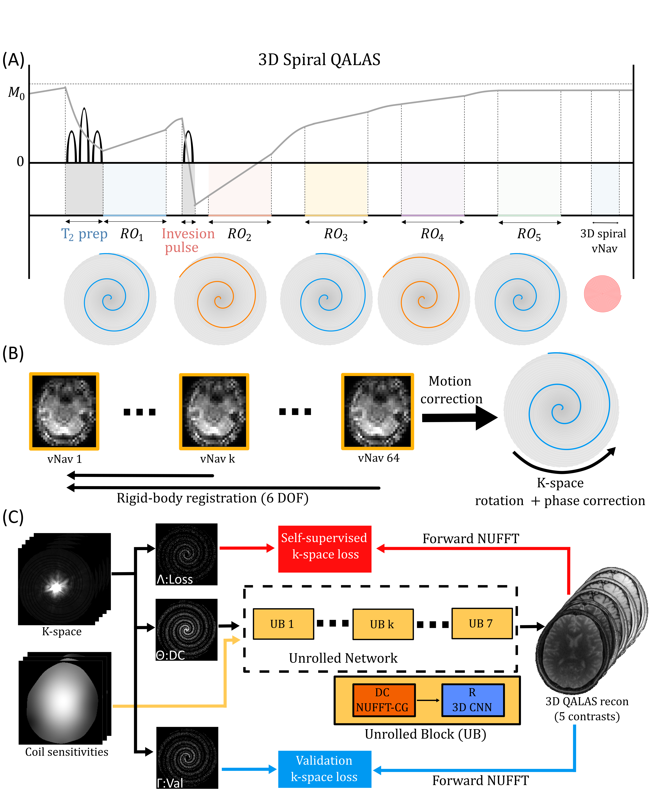

# 3D Spiral-QALAS with Motion Correction and Zero-Shot Self-Supervised Reconstruction

This repository contains the MATLAB and Python implementations accompanying our ISMRM 2027 work on accelerated 3D Spiral-QALAS acquisition with navigator-based motion correction and zero-shot self-supervised reconstruction.



**Figure 1.** Overview of the 3D Spiral-QALAS acquisition, volumetric navigator-based motion correction, and zero-shot self-supervised reconstruction framework.

## Overview

The proposed framework combines three components:

1. **3D Spiral-QALAS Acquisition:** Variable-density spiral readouts with five QALAS contrasts, implemented at 3T and 7T using Pulseq.
2. **Motion Correction:** Low-resolution 3D spiral volumetric navigators (vNavs) for rigid-body motion estimation and retrospective correction of k-space measurements and trajectories.
3. **3D Spiral ZS-SSL Reconstruction:** A zero-shot self-supervised unrolled reconstruction network combining nonuniform FFT (NUFFT) data consistency with learned 3D CNN regularization.

The reconstructed QALAS contrasts are subsequently used for quantitative T1, T2, proton density (PD), and inversion efficiency (IE) mapping.

## Repository Structure

```text
1_Sequences/
    3T/
    7T/

2_MoCo/
    motion_estimation_vnavs.m

3_Recon/
    prepare_spiral_qalas.m
    spiral_raw_io_moco.py
    ZS-SSL-NUFFT-FAST-3D_BATCH/
        zs_ssl_recon_python_fast_batch.py
        zs_ssl_inference.ipynb
        models/

figures/
    Figure1.png
```

## Implementation

The sequence generation and motion-estimation pipelines are implemented in MATLAB. Data preparation uses MATLAB and Python, while 3D Spiral ZS-SSL reconstruction is implemented in Python using PyTorch and MRI-NUFFT.

External dependencies include Pulseq, BART, and supporting MATLAB utilities. Local paths and acquisition settings should be configured for the target environment.

## Reference

*3D Spiral QALAS Acquisition with Motion Correction and Zero-Shot Self-Supervised Reconstruction.*

ISMRM 2027.
